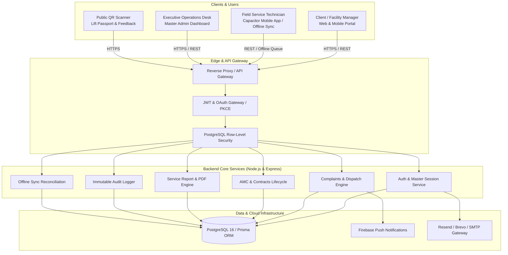

# WEPSUN Engineering Solution

> **Smart Lift Service Operations, AMC Lifecycle & Enterprise Breakdown Control Room Portal**  
> *ISO 9001:2015 Certified Elevator OEM Platform*

[](https://www.typescriptlang.org/)
[](https://react.dev/)
[](https://vitejs.dev/)
[](https://tailwindcss.com/)
[](https://capacitorjs.com/)
[](https://nodejs.org/)
[](https://expressjs.com/)
[](https://www.prisma.io/)
[](https://www.postgresql.org/)

---

## 📌 Overview

**WEPSUN Engineering Solution** is a unified, enterprise-grade multi-tenant platform designed to manage the end-to-end lifecycle of vertical transportation operations. The system bridges building managers, field technicians, and executive operations through real-time communication, offline-resilient field sync, and an automated 24/7 breakdown dispatch control room.

---

## 🚀 Key System Features

### 🏢 1. Client & Facility Manager Portal
- **Real-Time Breakdown Logging**: Direct complaint logging with photo and video capture, category tagging, and automatic severity estimation.
- **24/7 Control Room & Helpline**: Click-to-call emergency hotline (`+91 85959 40077`) with instant notification dispatch.
- **Digital Lift Passports & QR Scanning**: Instant access to lift compliance, technical specifications, and maintenance history via QR scanning.
- **Live Ticket Status & Tracking**: Live breakdown lifecycle tracking from intake to dispatch, on-site arrival, and signed job completion.
- **Service History & Invoices**: Access completed maintenance reports, downloadable PDF service receipts, and AMC contract statuses.

### 🔧 2. Field Service Technician Mobile App
- **Live Technician Radar & Dispatch**: Visual dispatch queue showing emergency calls, scheduled PMs, and assigned breakdown tickets.
- **Offline-First Resilience**: Full local cache support via IndexedDB and automatic bidirectional background sync queue (`syncQueue.ts`) for zero-connectivity environments.
- **Digital Service Reports**: Step-by-step checklist execution with photo evidence, parts replacement tracking, and client digital signature capture.
- **Preventive Maintenance (PM)**: Scheduled maintenance workflows with automated status reconciliation.

### 🛡️ 3. Executive Master Admin Control Room
- **Multi-Tenant Operations**: Centralized oversight across all buildings, societies, commercial complexes, and elevator units.
- **AMC & Warranty Lifecycle**: Proactive AMC contract renewal alerts, expiry tracking, and SLA enforcement.
- **Quotation & Work Order Manager**: Create, approve, and track commercial quotations, equipment upgrades, and work orders.
- **Comprehensive Audit Logging & RLS**: Immutable operational audit logging (`auditLogger.ts`) backed by PostgreSQL Row-Level Security policies.
- **Technician Workforce Management**: Performance metrics, job allocation, and route optimization.

---

## 🏛️ System Architecture



---

## 🛠️ Technology Stack

| Domain | Technologies |
|---|---|
| **Frontend Framework** | React 19, TypeScript, Vite 8, Rolldown / ESBuild |
| **Styling & Icons** | Tailwind CSS, Lucide React |
| **Mobile Integration** | Capacitor 8 (Android Native Container & Deep Links) |
| **Backend Runtime** | Node.js (v20+), Express 4.21, TypeScript, TSX |
| **Database & ORM** | PostgreSQL 16 (Supabase / Render / AWS RDS), Prisma ORM 6.4 |
| **Authentication** | JWT (Access + Refresh Token Rotation), Google OAuth (RFC 7636 PKCE), Firebase Auth |
| **Communications** | Resend HTTPS API, Brevo API, SMTP Fallback, WhatsApp Business API |
| **Deployment** | Vercel (Frontend SPA), Render (Backend Node API & Cron) |

---

## 📦 Directory Structure

```text
├── .github/                 # GitHub Actions CI/CD & keep-alive workflows
├── android/                 # Capacitor Android native project files
├── backend/                 # Backend REST API
│   ├── src/
│   │   ├── lib/             # Prisma client, audit logger, auth & email helpers
│   │   ├── routes/          # API route controllers (auth, complaints, amc, etc.)
│   │   ├── tests/           # Integration, security, and sync tests
│   │   └── server.ts        # Express server entry point
├── docs/                    # Architecture reports, RBAC matrix, and API docs
├── prisma/                  # Prisma schema, migrations, and seeds
├── public/                  # Public assets, favicon, splash screen, manifest
├── scripts/                 # Maintenance, backup/restore, and setup scripts
├── src/                     # React frontend source code
│   ├── components/          # Role-based UI components (admin, client, technician)
│   ├── context/             # AppContext & global state management
│   ├── services/            # Offline storage, sync queue, and API client
│   └── types/               # TypeScript domain interfaces
├── capacitor.config.ts      # Capacitor mobile runtime configuration
├── package.json             # Scripts and dependencies
├── render.yaml              # Render cloud infrastructure blueprint
├── vercel.json              # Vercel SPA routing and headers
└── vite.config.ts           # Vite build pipeline and bundle splitting
```

---

## 🚦 Getting Started

### Prerequisites
- **Node.js**: `v20.x` or higher
- **npm**: `v10.x` or higher
- **PostgreSQL**: `v16.x` (Local or cloud-hosted instance e.g. Supabase, Render)
- **Android Studio** *(Optional, for mobile APK/AAB build)*: Electric Eel or newer

### 1. Clone & Install Dependencies
```bash
git clone https://github.com/vighneshkulkarni897530-svg/Wepsun.git
cd Wepsun
npm install
```

### 2. Configure Environment Variables
Copy `.env.example` to `.env` and fill in your connection strings:
```bash
cp .env.example .env
```
Ensure the following key values are populated:
- `DATABASE_URL`: PostgreSQL connection string with SSL.
- `JWT_SECRET` & `REFRESH_TOKEN_SECRET`: Random 32-byte hexadecimal strings.
- `VITE_API_URL`: Backend API endpoint (e.g., `http://localhost:5000/api` for local development).

### 3. Initialize Database
```bash
# Generate Prisma Client
npm run db:generate

# Push schema to database
npm run db:push

# (Optional) Seed initial system structures
npm run db:seed
```

### 4. Start Development Servers
Run both the frontend and backend concurrently:
```bash
npm run dev
```
- **Frontend App**: [http://localhost:5173](http://localhost:5173)
- **Backend API**: [http://localhost:5000](http://localhost:5000)

---

## 🧪 Available Scripts

| Command | Description |
|---|---|
| `npm run dev` | Launch frontend and backend concurrently |
| `npm run build` | Compile TypeScript and bundle frontend for production |
| `npm run lint` | Run Oxlint on codebase |
| `npm run test` | Run complete backend test suite |
| `npm run test:enterprise-db` | Verify enterprise database architecture and RLS |
| `npm run db:generate` | Regenerate Prisma client |
| `npm run db:push` | Synchronize Prisma schema with the target database |
| `npm run cap:sync` | Build frontend and sync assets to Capacitor Android |
| `npm run cap:open:android` | Open native Android project in Android Studio |

---

## 📱 Mobile App (Android)

The application is fully configured as a hybrid mobile application via **Capacitor**:
1. Run `npm run cap:sync` to compile the web bundle and copy it to `android/app/src/main/assets/public`.
2. Open the project in Android Studio:
   ```bash
   npx cap open android
   ```
3. To build a debug APK directly from the CLI:
   ```bash
   npm run cap:build:apk
   ```

---

## 📖 Extended Documentation

Refer to the comprehensive technical documentation available in the [`docs/`](./docs) folder:
- [Enterprise Database Architecture](./docs/ENTERPRISE_DATABASE_ARCHITECTURE.md)
- [System Architecture Specification](./docs/SYSTEM_ARCHITECTURE.md)
- [API Architecture & Endpoints](./docs/API_ARCHITECTURE.md)
- [Database ER Diagram](./docs/DATABASE_ER_DIAGRAM.md)
- [Role-Based Access Control (RBAC) Matrix](./docs/RBAC_PERMISSION_MATRIX.md)
- [OTP & Email Infrastructure](./docs/OTP_EMAIL_ARCHITECTURE.md)

---

## 📞 Support & Helpline

- **24/7 Breakdown Control Room**: `+91 85959 40077`
- **Emergency Rescue Hotline**: `+91 85959 40077`
- **Official Portal**: [wepsunengineering.com](https://wepsunengineering.com)

---

*© 2026 WEPSUN Engineering Solutions. All rights reserved.*
